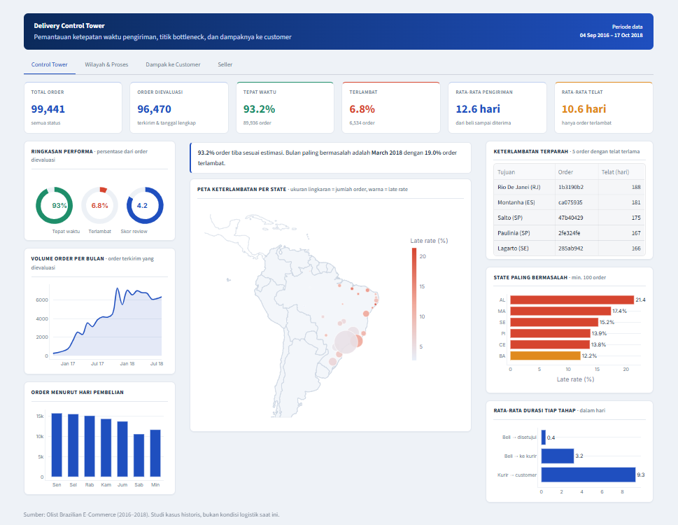

# 📦 Analisis Rantai Pasok & Performa Pengiriman (Control Tower)
### Analisis Logistik End-to-End & Dashboard Pusat Kendali Interaktif

Proyek portofolio Data Analyst ini bertujuan untuk menganalisis performa pengiriman barang (*delivery performance*), mendeteksi titik hambatan operasional (*bottlenecks*), mengevaluasi kinerja penjual (*seller*), dan mengukur dampak keterlambatan terhadap kepuasan pelanggan pada platform e-commerce Olist di Brasil (~100.000 transaksi pesanan, periode 2016–2018).

---

## 🎯 Pertanyaan Bisnis Utama
1. **Ketepatan Waktu:** Berapa persen pesanan yang berhasil sampai tepat waktu (*On-Time Rate*) dan berapa yang terlambat (*Late Rate*)?
2. **Titik Hambatan (Bottlenecks):** Di tahap operasional mana waktu paling banyak habis (verifikasi order, penyerahan paket oleh penjual ke kurir, atau perjalanan kurir ke pelanggan)?
3. **Analisis Wilayah (Geografi):** Daerah atau negara bagian (*state*) mana yang tingkat keterlambatannya paling parah?
4. **Kinerja Penjual (Seller):** Siapa saja penjual dengan tingkat keterlambatan tinggi yang perlu dibina?
5. **Dampak ke Pelanggan:** Seberapa besar penurunan nilai ulasan (*review rating*) jika pesanan datang terlambat?

---

## 📊 Ringkasan Temuan & Metrik Utama

| Metrik | Hasil Analisis | Keterangan & Konteks |
|---|---|---|
| **Total Pesanan** | **99.441** | Seluruh transaksi yang tercatat di database |
| **Pesanan Dievaluasi** | **96.470** | Status *delivered* dengan tanggal aktual & estimasi lengkap |
| **Tingkat Tepat Waktu (On-Time)** | **93,2%** (89.936) | Barang tiba sesuai atau sebelum tanggal estimasi |
| **Tingkat Keterlambatan (Late)** | **6,8%** (6.534) | Melewati tanggal estimasi yang dijanjikan |
| **Rata-rata Waktu Kirim** | **12,6 hari** | Dari pembeli memesan hingga barang diterima di alamat |
| **Rata-rata Keterlambatan** | **10,6 hari** | Rata-rata selisih hari khusus untuk pesanan yang telat |
| **Dampak ke Skor Ulasan** | **4.29 ⭐ vs 2.27 ⭐** | Pesanan telat mengalami penurunan skor drastis (-2.02 poin) |

### 🔍 Temuan Penting dari Data:
* **Perjalanan Kurir adalah Titik Paling Lama:** Waktu kurir membawa barang ke rumah pelanggan memakan waktu rata-rata **9,3 hari**, jauh lebih lama dibanding waktu penjual menyiapkan dan menyerahkan paket ke kurir (**3,3 hari**).
* **Wilayah Paling Rawan Keterlambatan:** Negara bagian **Alagoas (AL: 21,4% telat)**, **Maranhão (MA: 17,4% telat)**, dan **Rio de Janeiro (RJ: 12,1% telat dari 12.350 pesanan)** mencatat persentase keterlambatan tertinggi. RJ menjadi perhatian khusus karena memiliki volume pesanan yang sangat besar.
* **Lonjakan Musiman:** Keterlambatan melonjak tajam pada **Maret 2018 (19,0% telat)** dan **November 2017 (12,4% telat)** akibat lonjakan volume belanja musiman (*Black Friday*).

---

## 🖥️ Dashboard Pusat Kendali (Interactive Control Tower)
Dashboard interaktif dibuat menggunakan **Python (Streamlit & Plotly)** dengan tema korporat profesional yang terbagi dalam 4 tab halaman:

1. **Tab 1 — Control Tower:**
   * Kartu ringkasan 6 KPI utama.
   * Diagram lingkaran (*ring progress*) untuk rasio tepat waktu, telat, dan kepuasan pelanggan.
   * Tren volume pesanan bulanan dan sebaran hari belanja (Senin–Minggu).
   * Peta sebaran pengiriman Brasil interaktif (lingkaran proporsional per wilayah).
   * Tabel 5 pesanan dengan durasi keterlambatan paling parah.
2. **Tab 2 — Wilayah & Proses:**
   * Peringkat 12 *state* dengan tingkat keterlambatan tertinggi.
   * Grafik perbandingan volume pesanan vs tingkat keterlambatan (*scatter plot*).
   * Rincian durasi per tahap operasional (verifikasi, penyerahan ke kurir, perjalanan).
   * Histogram sebaran lama hari keterlambatan.
   * Hubungan antara besaran ongkos kirim terhadap persentase telat.
3. **Tab 3 — Dampak ke Customer:**
   * Perbandingan rata-rata bintang ulasan antara pesanan tepat waktu vs terlambat.
   * Grafik sebaran rating bintang 1 sampai 5.
   * Pola penurunan kepuasan berdasarkan lamanya hari keterlambatan (1–3 hari, 4–7 hari, dst).
4. **Tab 4 — Seller:**
   * Evaluasi penjual dengan filter minimal jumlah pesanan (agar adil).
   * Daftar penjual bermasalah dengan tingkat keterlambatan di atas 15%.
   * Matriks rute asal penjual ke tujuan pembeli (*heatmap corridor*).

## 🛠️ Alat dan Teknologi yang Digunakan
* **SQL (PostgreSQL):** Untuk audit data mentah, validasi duplikat, dan logika pembuatan tabel analitis.
* **Python (Pandas & NumPy):** Untuk pembersihan data, pengolahan metrik tanggal, dan analisis statistik di Jupyter Notebook.
* **Streamlit & Plotly:** Untuk pembuatan dashboard interaktif berbasis web dengan layout *Control Tower*.
* **Dataset:** [Brazilian E-Commerce Public Dataset by Olist](https://www.kaggle.com/datasets/olistbr/brazilian-ecommerce) (Kaggle).
